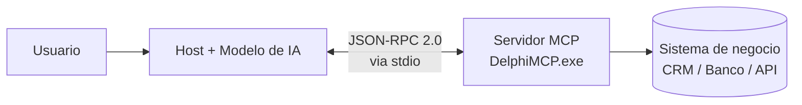
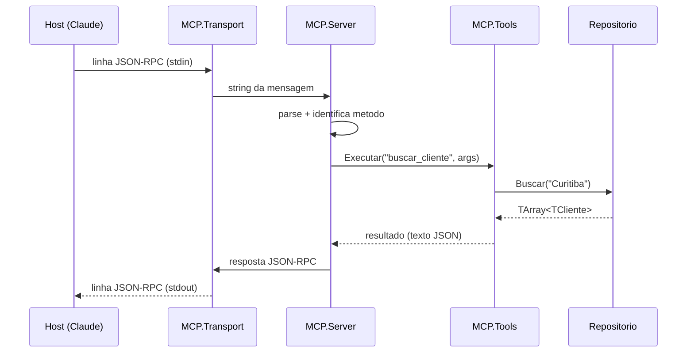

# DelphiMCP — Servidor MCP em Delphi

Um servidor **MCP (Model Context Protocol)** escrito em **Delphi / Object Pascal**,
que expõe funções de um sistema de negócio (um mini-CRM) como **ferramentas**
que uma IA — como o Claude — pode chamar diretamente.

Projeto criado como complemento ao vídeo **"MCP com Delphi"**.

---

## O que é MCP?

O **Model Context Protocol** é um padrão aberto (criado pela Anthropic) que
define **como um modelo de IA conversa com sistemas externos** — bancos de dados,
APIs, arquivos, sua própria aplicação. Em vez de cada integração ser "na marra",
o MCP padroniza a conversa usando **JSON-RPC 2.0**.

Pense no MCP como o **"USB-C das integrações de IA"**: um único conector padrão
para plugar qualquer ferramenta no modelo.

### Os três papéis

| Papel        | Quem é                         | Função                                            |
|--------------|--------------------------------|---------------------------------------------------|
| **Host**     | Claude Desktop, IDE, seu app   | Onde a IA "mora" e conversa com o usuário          |
| **Client**   | Dentro do host                 | Mantém 1 conexão com cada servidor                 |
| **Server**   | **Este projeto (Delphi)**      | Expõe ferramentas/dados para a IA usar             |



O modelo **não executa código sozinho**: ele pede ao servidor "execute a ferramenta
`buscar_cliente` com o termo `Curitiba`", e o **seu código Delphi** decide o que fazer.

---

## Como funciona (o protocolo em 3 passos)

A comunicação é feita por mensagens **JSON-RPC 2.0**, uma por linha, trafegando
pela entrada/saída padrão (**stdio**):

1. **`initialize`** — aperto de mão. O host pergunta a versão do protocolo e as
   capacidades; o servidor se apresenta.
2. **`tools/list`** — o host pergunta "quais ferramentas você tem?". O servidor
   devolve nome, descrição e o *JSON Schema* dos argumentos de cada uma.
3. **`tools/call`** — o modelo decide usar uma ferramenta; o host envia os
   argumentos, o servidor executa e devolve o resultado em texto.

Exemplo real de uma chamada e sua resposta:

```jsonc
// Host -> Servidor
{"jsonrpc":"2.0","id":5,"method":"tools/call",
 "params":{"name":"buscar_cliente","arguments":{"termo":"Curitiba"}}}

// Servidor -> Host
{"jsonrpc":"2.0","id":5,"result":{"content":[{"type":"text",
 "text":"[{\"id\":3,\"nome\":\"Ana Costa\",\"cidade\":\"Curitiba\"}]"}],"isError":false}}
```

---

## Ferramentas expostas por este servidor

| Ferramenta         | Descrição                                        | Argumentos                 |
|--------------------|--------------------------------------------------|----------------------------|
| `ping`             | Verifica se o servidor está ativo                 | —                          |
| `listar_clientes`  | Lista todos os clientes                           | —                          |
| `buscar_cliente`   | Busca por nome, cidade ou e-mail                  | `termo`                    |
| `criar_cliente`    | Cadastra um novo cliente                          | `nome`, `email`, `cidade`  |

Os dados ficam em memória (`Clientes.Repositorio.pas`). Num caso real, aqui você
plugaria **FireDAC**, um serviço REST, ou qualquer regra de negócio já existente.

---

## Requisitos

- **RAD Studio / Delphi** (testado com a versão **37.0 / RAD Studio 13**; compila
  em qualquer Delphi moderno com suporte a `System.JSON` e inline variables).
- Windows.
- Apenas a **RTL** — sem dependências externas.

---

## Como compilar

### Opção 1 — Linha de comando (mais rápido)

```bash
build.bat
```

O script chama o `rsvars.bat` do RAD Studio e gera `bin\DelphiMCP.exe`.
Se a sua versão do Studio for diferente de `37.0`, edite a variável
`STUDIO_VER` no topo do `build.bat`.

### Opção 2 — Pela IDE

Abra `src\DelphiMCP.dproj` no RAD Studio e pressione **Shift+F9** (Build).

---

## Como testar sem a IA

O servidor fala JSON-RPC pela stdin/stdout, então dá para testar com um arquivo
de mensagens:

```powershell
Get-Content testes\requisicoes.jsonl | .\bin\DelphiMCP.exe
```

Cada linha de saída é uma resposta JSON-RPC. Os logs de diagnóstico saem pelo
**stderr** (não poluem o canal do protocolo).

---

## Exemplo de como conectar ao Claude Desktop

1. Compile o projeto (`build.bat`).
2. Abra o arquivo de configuração do Claude Desktop:
   `%APPDATA%\Claude\claude_desktop_config.json`
3. Adicione o servidor (veja `config\claude_desktop_config.example.json`):

   ```json
   {
     "mcpServers": {
       "delphi-crm": {
         "command": "C:\\Users\\fsilva\\Documents\\GitHub\\MCP\\bin\\DelphiMCP.exe",
         "args": []
       }
     }
   }
   ```

4. Reinicie o Claude Desktop. As ferramentas aparecerão no ícone de conectores.
5. Peça algo como: *"Liste meus clientes de Curitiba"* ou *"Cadastre o cliente
   Pedro Lima, de Recife"*.

---

## Estrutura do projeto

```
MCP/
├── build.bat                     # Compila via linha de comando
├── README.md
├── src/
│   ├── DelphiMCP.dpr             # Programa principal (console)
│   ├── DelphiMCP.dproj           # Projeto do RAD Studio
│   ├── MCP.Transport.pas         # Leitura/escrita stdio (UTF-8, linha a linha)
│   ├── MCP.Server.pas            # Dispatcher JSON-RPC + métodos MCP
│   ├── MCP.Tools.pas             # Catálogo e execução das ferramentas
│   └── Clientes.Repositorio.pas  # "Sistema de negócio" (CRM em memória)
└── testes/
    └── requisicoes.jsonl         # Mensagens de exemplo para teste manual
```

### Fluxo interno



---

## Licença

MIT. Use, modifique e adapte à vontade.
